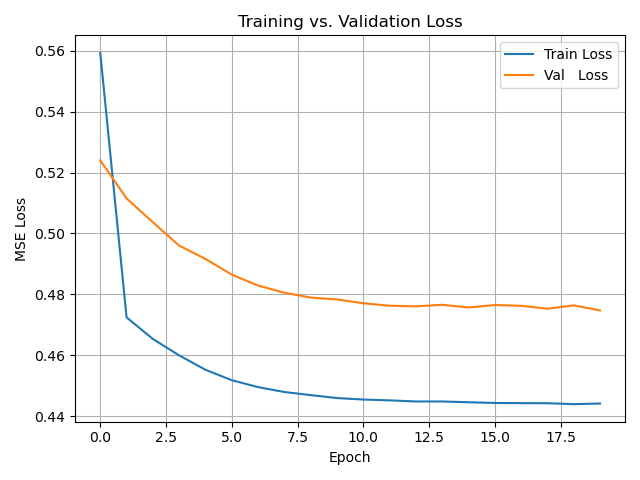

# Graph Neural Networks on METR-LA

This repository provides a hands-on implementation of spatio-temporal Graph Neural Networks (GNNs) for traffic forecasting on the METR-LA dataset. Its goal is to help understand, experiment with, and extend state-of-the-art graph-based models in PyTorch Geometric Temporal.

## 📂 Repository Structure

```
├── data/                   # Raw and processed adjacency matrices and sensor metadata
├── processed_data/         # Preprocessed traffic sequences (X_train, y_train, etc.)
├── models/                 # Model definitions (A3TGCN, custom STGCN blocks, etc.)
│   ├── A3TGCN.py
│   └── custom_stgcn_block.py
├── utils/
│   ├── data_processing.py  # Used to generate processed data from METRLA dataset
├── train.py                # Training and evaluation script
├── requirements.txt        # Python package dependencies
└── README.md               # This file
```

## Getting Started

### 1. Clone this repository

```bash
git clone https://github.com/yourusername/graph-gnn-metrla.git
cd graph-gnn-metrla
```

### 2. Create and activate a Conda environment

```bash
conda create -n graph-gnn python=3.10
conda activate graph-gnn
```

### 3. Install dependencies

```bash
pip install -r requirements.txt
# or, for GPU Mamba users:
mamba install -c pytorch -c nvidia pytorch torchvision torchaudio pytorch-cuda=11.8
pip install torch-geometric torch-geometric-temporal
```

GPU use is strongly recommanded, the A3TGCN blocks used are computationnally expensive.

## 📊 Download & Preprocess METR-LA Data

1. Download raw METR-LA data from the [official source](https://github.com/liyaguang/DCRNN).
2. Place the adjacency matrix (`adj_METR-LA.pkl`) in `data/`.
3. Run the preprocessing script to generate `processed_data/metr_la_preprocessed.npz`.

## 🎯 Training & Evaluation

Train the A3TGCN model:

```bash
python train.py
```

This script will:

* Load the preprocessed METR-LA data
* Initialize the `A3TGCN` model on GPU (if available)
* Train for the specified number of epochs, logging train/val MSE
* Save the best model weights as `a3tgnn_metrla.pth`
* Plot the train vs. validation learning curves

## 🔍 Model Architecture

* **A3TGCN**: Attention-based recurrent GNN cell that learns temporal attention over historical steps, combined with spatial graph convolutions.
* **Alternative blocks**: Custom STGCN blocks using Chebyshev graph convolutions and 1D temporal kernels. Unusable as of right now, needs vectorization to be efficient.

## 📈 Results



* Typical Test MSE: *\~0.55* (with default hyperparameters)
* Training/Validation gap: *<10%* (*Must implement regularization and early-stopping*)

## 🔧 Customization

* Adjust hyperparameters in `train.py` (learning rate, batch size, epochs).
* Swap between `A3TGCN2` and `custom_stgcn_block` in `models/`.
* Add additional features (weather, time-of-day embeddings) to improve performance.
